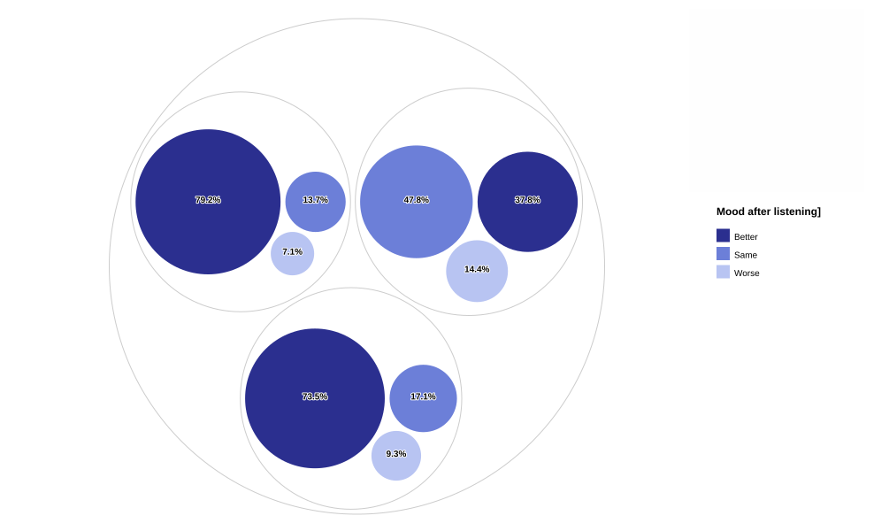
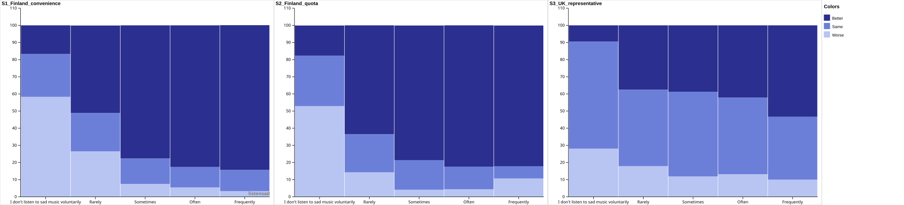
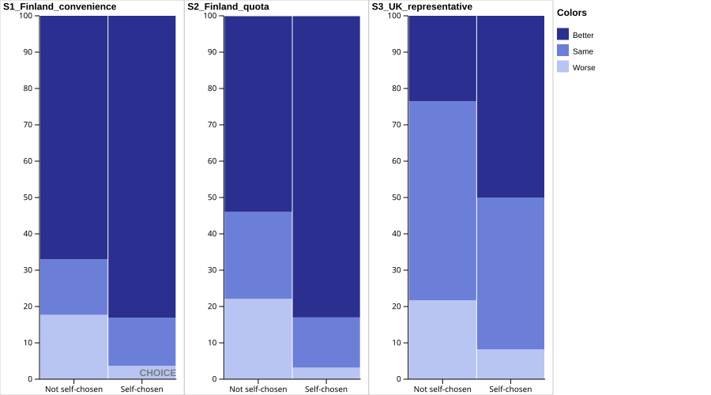
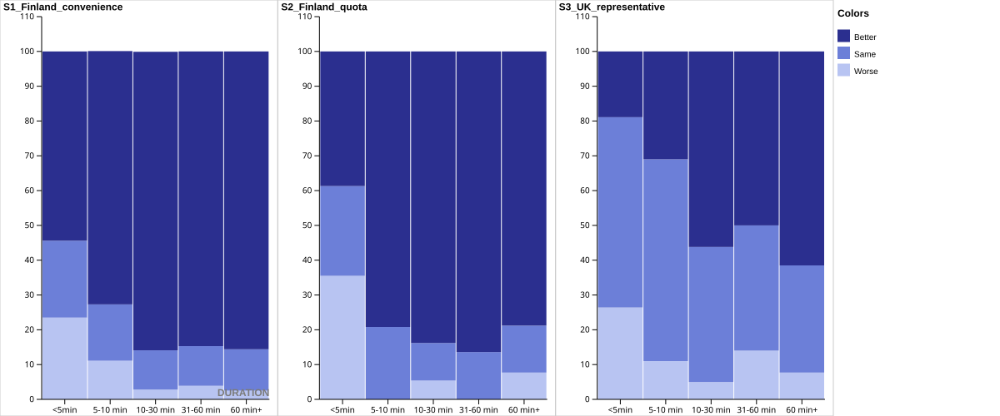
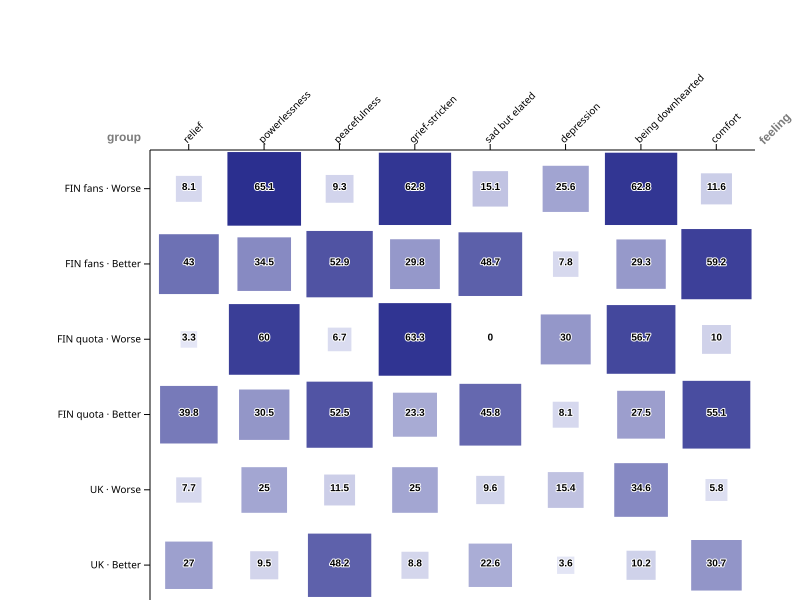
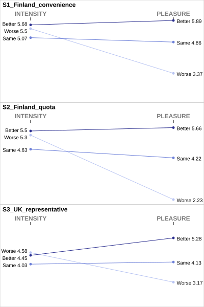
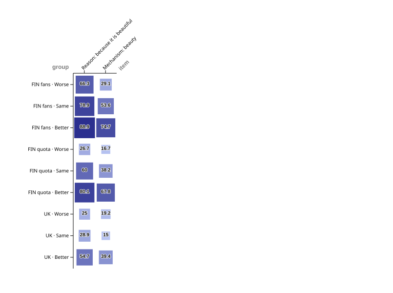

# The Thin Line Between Melancholy and Rumination

What happens when we listen to sad music? This is a learning project on **who feels better and who feels worse after sad music**, when it comforts us and when it may pull us down.

*I built this project slowly, step by step alongside my studies, out of curiosity and to learn.*

### Why this project?

Many people say that music influences us strongly and that we should be careful about what we listen to. Some even talk about certain frequencies having special effects.

I noticed that I personally listen to a lot of melancholic music, and that it does me good. In everyday life there are not many moments where I simply allow my emotions to be there, without thinking about them too much, without feeling bad and without falling into a low. For me, sad music works like a safety net.

That made me wonder why other people see it differently, and how many people feel the way I do.

For me, music is also art. Through music, people can get to know themselves better or close a chapter of their lives. Some songs I never listen to again, because they belong to a certain time. Others feel like they were written just for me, or they hold memories.

Listening with headphones can feel like a small survival kit. You switch off for a moment, but without losing touch with reality. In that moment you are vulnerable, but nobody around you notices.

I also find that many songs tell the artist's own story. When you really listen and empathise with them, you value their art more, a bit like visiting a museum. You do not always have to project yourself into it. Otherwise you only consume the music instead of really appreciating it.

These are personal observations, not scientific facts. With this project, I want to find out what research and data actually say.

### Research question

Who feels better and who feels worse after a memorable experience with sad music, and how do their reasons and feelings differ?

1. **Observe.** How do people feel after listening to sad music, better, the same or worse?
2. **Compare.** Do people who listen to sad music often feel different from people who rarely do?
3. **Understand.** Which feelings, reasons and attitudes go along with feeling better or worse?
4. **Reflect.** Where is the line between melancholy that helps and rumination that pulls us down?

### Reflection

Is it healthy to seek out sadness on purpose? Can sad music help us process our emotions, or can it keep us stuck in them? The answer is probably different for each person, and data alone cannot fully answer it. But I want to keep this question in mind throughout the project.

### Key concepts

1. Melancholy vs. rumination
2. Emotion regulation
3. The paradox of enjoying sad music
4. Empathy and being moved by art
5. What people report about themselves vs. measurements of the brain and body

### Data and sources

The data comes from Eerola, T. (2016). *Survey Data on Memorable Experiences with Sad Music – Reasons, Reactions and Mechanisms of Three Types of Experiences.* Harvard Dataverse. https://doi.org/10.7910/DVN/GLSIXB (CC0 1.0)

It is a survey with about 2,400 people from Finland and the UK, who described a memorable experience with sad music. You can find more details in [`data/raw/README.md`](data/raw/README.md).

For background reading I use three studies.

1. Eerola, T. & Peltola, H.-R. (2016). Memorable experiences with sad music – reasons, reactions and mechanisms of three types of experiences. *PLOS ONE*, 11(6), e0157444. https://doi.org/10.1371/journal.pone.0157444  
   This is the study behind the dataset.
2. Garrido, S. & Schubert, E. (2015). Moody melodies: Do they cheer us up? A study of the effect of sad music on mood. *Psychology of Music*, 43(2), 244–261. https://doi.org/10.1177/0305735613501938  
   Here mood got worse after sad music, and rumination was measured.
3. Taruffi, L., Pehrs, C., Skouras, S. & Koelsch, S. (2017). Effects of sad and happy music on mind-wandering and the default mode network. *Scientific Reports*, 7, 14396. https://doi.org/10.1038/s41598-017-14849-0  
   This study shows that sad music turns thoughts inwards.

### Why not streaming data?

It would have been easy to use data from streaming platforms such as Spotify. But streaming data only shows *what* was played, not whether people listened consciously or just let a playlist run, and not how they felt before or after. For my question, I need people's own descriptions of their feelings. That is why I chose survey data instead.

### Project structure

| Folder / file | Content |
|---|---|
| `data/raw/` | original data and documentation (never modified) |
| `data/processed/` | cleaned data in `sad_music_clean.csv` (2,436 people, all three samples in one table) |
| `notebooks/` | the analysis, step by step (see [`notebooks/README.md`](notebooks/README.md)) |
| `src/` | the same steps as the notebooks, as scripts that run in one go |
| `results/` | all tables from the analysis as CSV files, made by `src/analysis.py` |
| `AI_USAGE.md` | how I use AI in this project |

### Status

The project is complete. I explored and cleaned the data, analysed it step by step (including a data quality check and statistical tests) and visualised the results. All steps can be repeated with the scripts in `src/`.

### Results

I sorted the results by the four questions from the beginning.

#### 1. Observe. How do people feel after listening to sad music?

In both Finnish samples, about three out of four people felt better after their memorable experience with sad music (79 % and 74 %). In the UK only 38 % felt better, and "the same" was the most common answer (48 %). Only a few people felt worse in all three samples. Age does not explain the difference between the countries.

#### 2. Compare. Do people who often listen to sad music feel different?

The more often people listen to sad music, the more often they felt better afterwards, and this is true in all three samples. From "Sometimes" on, the two Finnish samples look almost the same. So the higher numbers among the fans seem to come from listening more often, not from being a fan as such.

#### 3. Understand. What goes along with feeling better or worse?

##### The situation

People who did not choose the music themselves felt worse about four to seven times as often (18 to 22 % compared to 3 to 8 %). People who listened for less than five minutes also felt worse much more often. Both effects are significant in all three samples. The direction is unclear though, because people who feel bad may simply stop listening sooner.

##### The feelings

People who felt better often felt comfort, relief and peacefulness, and "sad but elated" stands out in all three samples. People who felt worse more often felt powerlessness, grief and being downhearted, but this pattern is clearer in Finland than in the UK.

##### Strong, but differently pleasant

Both scales go from 1 to 7. People who felt better and people who felt worse rated their experience as almost equally intense. What separates them is how pleasant it felt. The "Worse" group is even below the middle of the scale.

##### Beauty as the common thread

Beauty shows up again and again. "Because it is beautiful" is the only reason that is significant in all three samples, and beauty as part of the experience is too. In every sample, the people who felt better named beauty most often. Memories, on the other hand, made no difference.

#### 4. Reflect. Where is the line between melancholy and rumination?

This question cannot be answered with a chart, because rumination was not measured in this survey. What the data does show is that the people who felt better chose the music, took their time and experienced it as beautiful and comforting. The people who felt worse had an equally strong experience, but it felt unpleasant. Maybe this is where the line lies, not in how deeply the music moves us, but in whether we can still find something beautiful in it. This is my interpretation, not a proven result.

The full analysis and my conclusion are in [`notebooks/03_analysis.ipynb`](notebooks/03_analysis.ipynb).

### Limitations

The data is based on what people report about themselves, and they remember one past experience. This shows how they experienced it, not what happened in the brain. Rumination was not measured directly, so feeling worse after sad music is only a hint and not proof of a downward spiral. I only found connections, not causes.

The samples differ in country and in how people were recruited. Sample 1 is mostly fans of sad music, so the UK can best be compared with sample 2. Some groups were small, for example only 22 people in sample 2 who did not know the music. The attitude answers (ASM) from the UK were not reliable, so I left them out of my conclusions.

### How to run

1. Install Python 3 and the packages with `pip install -r requirements.txt`
2. Run `python src/clean.py` to create the clean data
3. Run `python src/analysis.py` to create all tables in `results/`

The notebooks in `notebooks/` show the same steps with my notes and thoughts. The scripts are the quick way to repeat everything.

### Tools

Python (pandas, matplotlib, scipy), Jupyter, Git and GitHub. The charts 2 to 6 and the final version of chart 1 were made with [RAWGraphs](https://www.rawgraphs.io) and refined in Inkscape.

### Next ideas

I would like to try a decision tree one day, to see which factors together best separate the people who felt better from those who felt worse. Later I also want to connect this project with neuroscience and compare what people report with what actually happens in the brain.

### Use of AI

This is a learning project, and I use Claude (Anthropic) as a tutor. In exploration and cleaning, most of the code was written by Claude based on my instructions. I ran and checked every step and made all decisions about the data. From the analysis on, I write more of the code myself.

The topic and research question are my own, and so is the approach, for example first going through all 131 columns, then deciding what is relevant, and exploring each sample separately. The choice of data and columns and the interpretation are also mine.

You can read more in [AI_USAGE.md](AI_USAGE.md).

### Licence

Code in this repository is licensed under the [MIT License](LICENSE). The data is CC0 1.0 (Eerola, 2016).